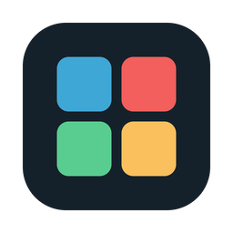
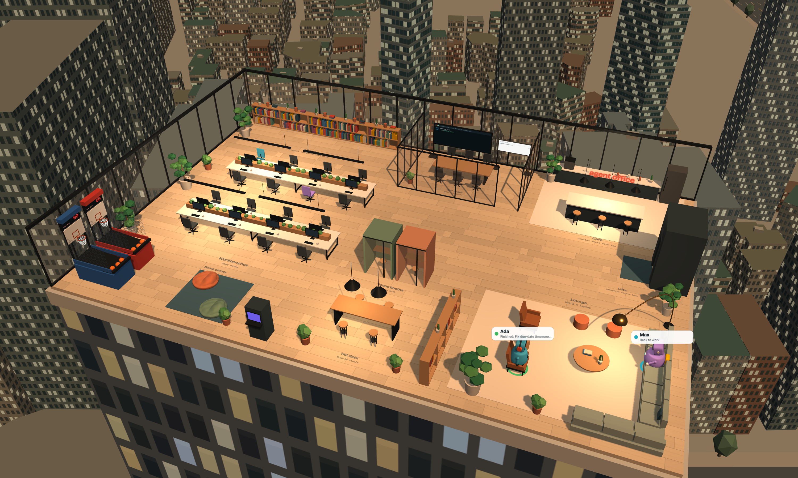
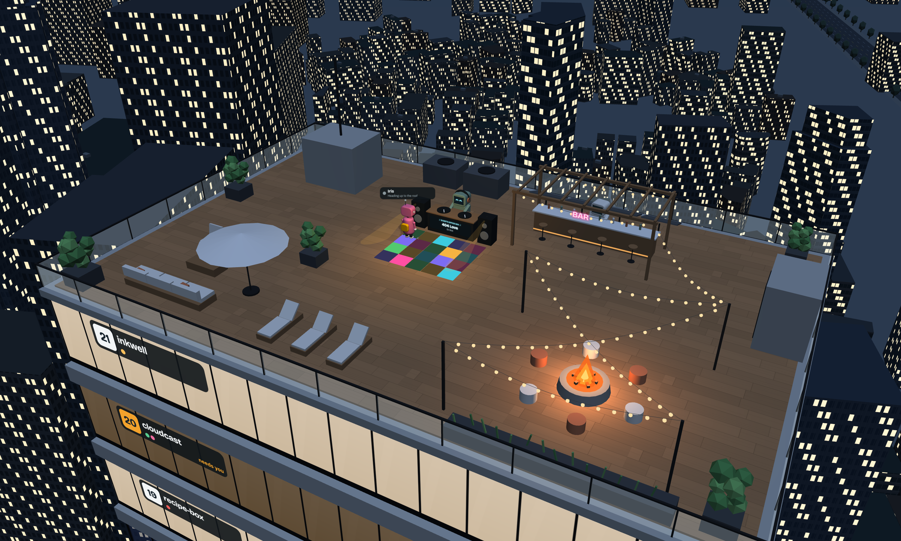

#  Agent Office

Agent Office shows your coding agents as characters in a 3D office.

Each Claude Code session is one agent. The session can be in the **Claude desktop app** or in the **terminal**. The agent comes up in the lift and sits at a desk. It goes to the library when it reads many files. It lifts a hand when it needs your permission. It goes to the lounge when it is done.

Subagents are smaller teammates. When a subagent is done, it stays at its desk. Its main agent walks to it, looks at the work, and then lets it go.

The office works in a browser on your computer. Support for phones and VR headsets is on the roadmap.



*This is the demo scene, at 3000 × 1800 pixels. The projects are not real. The Seoul skyline is artistic. City footprints © [OpenStreetMap contributors](https://www.openstreetmap.org/copyright). Click the image to see the full size.*

> **Preview.** Agent Office is new. It works best on a Mac. Apple signs and notarizes the desktop app.
>
> The **Open chat** button uses the way the Claude app and the Codex app open chats today. These apps do not document this. If they change it, the button only brings the app to the front.
>
> We welcome issues and ideas.

## Contents

- [Features](#features)
- [Quick start](#quick-start)
- [Other coding agents](#other-coding-agents)
- [Desktop app (macOS)](#desktop-app-macos)
- [How it works](#how-it-works)
- [Characters](#characters)
- [Day and night](#day-and-night)
- [Rooftop DJ](#rooftop-dj)
- [Open an agent's chat](#open-an-agents-chat)
- [App logos](#app-logos)
- [Warnings](#warnings)
- [Approve from the office](#approve-from-the-office)
- [Options](#options)
- [Remove the hooks](#remove-the-hooks)
- [Development](#development)
- [Contributing](#contributing)
- [License](#license)
- [Roadmap](#roadmap)

## Features

### Agents in the office

- Each Claude Code session is one agent. Sessions from the desktop app and from the terminal both show.
- Each project has its own floor.
- Agents that already run when the office starts move in at once. The office reads the logs of Claude Code, Codex and Cursor for this.
- The name of an agent is the title of its chat. If the chat has no title, the office uses the first prompt.
- Subagents are smaller "intern" versions of their main agent. The name of a subagent is its task.
- A main agent reviews the work of a finished subagent before the subagent leaves.
- Chats that you archive in the Claude desktop app do not show in the office.
- When an agent merges a pull request or a branch, it cheers. The office shows a message and a "Merged" line in the live feed.

### Where agents go

- Agents walk to a desk, the library, the lounge, the war room, the coffee bar, the basketball machines, the arcade and the rooftop.
- An agent that reads three or more files in a row goes to the library.
- An agent that does web research goes to the lounge.
- An agent in plan mode goes to the war room.
- A finished agent takes a break after 45 seconds.
- Agents look around, stretch and drink coffee while they work.
- Agents get coffee at the coffee bar and hold it for two minutes.
- Agents hold a closed laptop when they walk on an office floor.
- An agent that thinks at a desk sits back and turns its chair slowly.

### Characters

- Two crews: **Pets** and **Robots**.
- Pets: bear, cat, rabbit, Maltese, raccoon and duck.
- Change the face, body shape, colors and accessories of each agent.
- Accessories: headphones, beanie, cap, glasses, antenna, scarf, backpack and mug.
- The face and a chest light show the status of the agent.

### The office

- A **3D** view and a **Plan** view.
- The camera flies between floors in one smooth movement.
- **Day and night** themes. The **Auto** theme follows your clock.
- City views: **Seoul**, **San Francisco** or **Generic city**.
- A rooftop party at night, with a DJ, a dance floor, a bar and a fire pit.
- The rooftop DJ can show the song that plays in Spotify or Apple Music.
- A first-visit tour. You can skip it or start it again.
- A demo mode with sample agents.

### Panels and cards

- An **Agents** list, a **Live feed** and a **Customize** panel.
- Each agent has a card with a **Chat** tab and an **Activity** tab.
- The **Chat** tab shows your prompts and the replies of Claude.
- An **Open chat** button takes you to the chat of the agent in its app.
- The office shows the logo of the tool for each floor and agent.
- A soft sound plays when an agent is done, needs you, or merges. You can turn it off in **Customize → Sounds**.
- The layout works on phones.

### Warnings

- **Same file:** two agents edit the same file in 5 minutes.
- **Repeated failures:** the same tool call fails 3 times.
- **Memory:** the chat of an agent fills the context window.

### Permissions

- Allow or deny a Claude Code permission request from the office.

### Desktop app (macOS)

- A menu-bar app with the office server in it. You do not need Node.
- The menu-bar icon shows how many agents need you.
- macOS notifications when an agent asks for permission or is done.
- **Connect agents** installs the hooks for Claude Code, Codex and Cursor with one click.
- The app updates itself. It also updates the Claude Code plugin.

### Other tools

- Codex CLI, Cursor, Gemini CLI, GitHub Copilot CLI, Qwen Code, Factory Droid, Goose, Kiro, Windsurf, Cline, OpenCode and Amp can send their status to the office.
- Models that Ollama has loaded show as agents on an Ollama floor.

### Privacy

- The server listens only on `127.0.0.1`. No data goes out of your computer.

## Quick start

### On a Mac

1. Download the DMG file from the [latest release](https://github.com/regisBafutwabo/agent-office/releases/latest).
2. Drag **Agent Office** to **Applications**.
3. Open **Agent Office**.
4. Click **Connect Claude Code**.
5. Start a new agent session.

To connect other tools, go to **Customize → Connect agents**. Each **Connect** button installs the hooks for one tool. Start a new agent session after you connect a tool.

For more information, see the [installation guide](INSTALL.md).

### From source

The [installation guide](INSTALL.md) has the full steps and help for problems. These are the short steps.

1. Get the code and start the office:

   ```bash
   git clone https://github.com/regisBafutwabo/agent-office.git
   cd agent-office
   npm install
   npm start                # starts the office at http://localhost:4747
   ```

2. Install the hooks one time. The hooks tell the office what Claude Code does.

   ```bash
   claude plugin marketplace add "$(pwd)"
   claude plugin install agent-office@agent-office
   ```

3. Open a **new** Claude Code session in the desktop app or in the terminal.
4. Send a prompt. Its agent comes into the office.

To try the office without Claude Code, open <http://localhost:4747/?demo>. This shows agents that are not real.

## Other coding agents

These tools can also send their status to the office: Codex CLI, Cursor, Gemini CLI, GitHub Copilot CLI, Qwen Code, Factory Droid, Goose, Kiro, Windsurf, Cline, OpenCode and Amp. They use `adapters/hook.sh`.

The desktop app connects Codex and Cursor with one click. Use **Connect agents** in the menu bar or in **Customize**. For the other tools, see [docs/adapters.md](docs/adapters.md). This works with the desktop app and with `npm start`.

**Ollama** needs no setup. Each model that Ollama has loaded shows on an Ollama floor.

- The agent is busy when the model answers.
- The agent is idle when the model waits.
- The agent goes away when Ollama unloads the model.

Ollama does not tell which tool or project sent a prompt. Thus Ollama agents cannot ask for permission and cannot show the chat.

## Desktop app (macOS)

The desktop app is a 4 MB menu-bar app. The office server is in the app. Thus you do not need `npm start` or Node.

- The menu-bar icon shows how many agents need you.
- macOS tells you when an agent asks for permission.
- **Connect agents** installs the Claude Code plugin with one click. It can also add the hooks for Codex or Cursor. You do not need this repository.
- New versions of the app update the plugin automatically.
- **Open Agent Office** shows the 3D office in a window.
- When you close the window, the app frees its memory. The server continues to run in the menu bar until you quit.
- The app updates itself. To get a new version now, choose **Check for Updates…**. This item is in the menu-bar menu and in the Agent Office menu.
- Phones and browsers can also open <http://localhost:4747>.

### Build the desktop app

You need Rust. To install Rust, run `brew install rustup && rustup default stable`.

```bash
cd desktop
npm install
npm run dev      # run it
npm run build    # Agent Office.app and a .dmg in src-tauri/target/release/bundle/
```

Your own build has an ad-hoc signature. Thus other Macs can show a warning that Apple cannot verify the developer. To open the app, follow the [first-launch steps](INSTALL.md#allow-the-first-launch).

## How it works

```
Claude Code (desktop app / terminal)
   │  hooks from the agent-office plugin (plugin/hooks)
   ▼
bridge/server.js  ── keeps live state of every session and subagent
  (or the desktop app's built-in Rust server: desktop/src-tauri)
   │  WebSocket
   ▼
web/index.html    ── the 3D office (Three.js)
```

- The hook script of the plugin sends each event to `http://127.0.0.1:4747/hook`.
- The hook script stops after one second. It does not block Claude Code. It does not change what Claude Code does.
- The bridge listens only on `127.0.0.1`. No data goes out of your computer.
- The office shows your prompts and file names. Keep it as private as your terminal.
- Placement rules in `web/index.html` tell agents where to go. Search for "Placement rules" in that file.

## Characters

Agents are small robots with a screen as a face. The face shows what the agent does:

| Face | Status |
|---|---|
| Eyes look up, with "…" | Thinks |
| Focused eyes | Works |
| A large "!" | Needs you |
| Happy ^ ^ | Done |
| Sleepy zZ | Idle |
| A frown | Failed |

A light on the chest shows the same status color.

When you open the office for the first time, select **Pets** or **Robots**. Pets are a bear, a cat, a rabbit, a Maltese, a raccoon and a duck.

To change the crew, go to **Customize → Agents**. You can change these items for each agent:

- The animal or robot face
- The body shape
- The colors
- The accessories: headphones, beanie, cap, glasses, antenna, scarf, backpack and mug

The office keeps these settings for each project.

Subagents look like a smaller "intern" version of their main agent. Agents from other tools get an accessory automatically. For example, Cursor agents wear headphones and Codex agents wear a cap. To compare looks, open `prototype/character-lab.html`.

### First-visit tour

The tour shows how these items work:

- Project floors
- Agent activity
- Tool connections
- Permission requests

You can skip the tour at any time. To see it again, go to **Customize → Getting started**. If no agents run, click **Try demo** to see a sample team. The tour can then take you back to your live office to connect your tools.

## Day and night

By default, the office follows your clock (**Customize → Office theme → Auto**):

| Time | Light |
|---|---|
| 0:00 to 5:00 | Night |
| 5:00 to 8:00 | Dawn, then daylight |
| 8:00 to 17:00 | Daylight |
| 17:00 to 20:00 | Golden hour, then night |
| 20:00 to 24:00 | Night |

The colors and light change slowly between these times. The sun moves across the sky in the day. The city lights come on in the evening.

To keep one theme, select a different theme. The office keeps your selection.

### City

On your first visit, select **Seoul**, **San Francisco** or **Generic city**. To change it later, go to **Customize → City**.

City views use OpenStreetMap footprints, landmarks and artistic scenery. The windows light up at night. The office keeps your selection on this device. To change the office centers or bake the city data again, see [the city data notes](web/cities/README.md).

## Rooftop DJ

[](docs/images/rooftop-party.png)

*The night scene of the demo. City footprints © [OpenStreetMap contributors](https://www.openstreetmap.org/copyright).*

The rooftop DJ can play the music that you listen to. It is off by default.

To turn it on:

1. Go to the rooftop.
2. Click **Play my music** at the top.
3. macOS asks one time if Agent Office can see Spotify and Music. Allow it.

The office then asks the Spotify app for the current song. If Spotify plays nothing, it asks Apple Music. The song shows on the front of the DJ booth.

- When your music is on, the DJ also plays in the day.
- The full party (lights, fire and bar) starts only when it is dark.
- When no music plays, the DJ plays its own office mix. These songs are not real.

The office checks for music only when an office page has music turned on. It does not open Spotify or Music. No data goes out of your computer. To stop, click the button again.

The permission belongs to Agent Office. With `npm start`, it belongs to your terminal. To change it, go to **System Settings → Privacy & Security → Automation**.

The dance floor uses its own beat, because Spotify does not share the tempo of a song.

## Open an agent's chat

Each live agent has an **↗** button in the agent list. Its card has an **Open chat** or **Open in …** button. When an agent is done, a message shows with the same button. One click takes you back to the agent.

| App | What the button does |
|---|---|
| Claude desktop app | Opens that chat. You need plugin 0.4.0 or later. |
| Codex app | Opens that thread. |
| Terminal and iTerm | Selects the tab of that session. |
| Cursor, VS Code, Windsurf, Zed | Opens the window of that project. The agent chat is in that window. |
| Other apps | Brings the app to the front. |

The desktop app asks one time for permission to control Terminal or iTerm. It opens only apps from a fixed list of coding tools. It makes chat links only from validated IDs. See `desktop/src-tauri/src/focus.rs`. This feature works on macOS only.

## App logos

The floors and agents show the logo of their tool (Claude, Codex, Cursor and others). You see the logos in the **Floors** list, in the agent list and on the floor signs.

The office reads the icons of the apps on your Mac from macOS. Thus this repository does not include logo images. Tools without an app on your Mac show a badge with a letter. The claude.ai preview also shows a badge.

## Warnings

The office tells you about three problems:

- **Same file:** two agents edited the same file in 5 minutes. A red bar connects the two agents. Each card shows the other agent. One agent can overwrite the work of the other.
- **Repeated failures:** the same tool call (for example, `npm test`) failed 3 times and never passed. The agent lifts its hand. It shows a red marker and a "?" on its face. A new prompt, a passed run, or the end of the task removes the warning.
- **Memory:** each Claude Code agent has a cup on its name tag. The cup becomes empty as the chat fills the context window. The card shows the number of tokens. At 80%, the office tells you that Claude Code will compact the chat soon. Transcripts do not give the size of the window. Thus the office uses 200k tokens until a chat has more. Then it uses 1M tokens.

The first two warnings are only in the open office page. When you reload the page, they go away. They are not in the count on the menu-bar icon.

## Approve from the office

When an agent needs permission, it lifts its hand. Its floor flashes amber.

If the office is open on your screen, you can answer in the office. Use the card of the agent or the alert. Click one of these buttons:

- **Allow**
- **Deny**
- **Answer in Claude Code**

Important information:

- Claude Code runs its permission hook *before* it shows its own dialog. Thus the office holds a request only when one or more office pages are visible.
- The office holds a request for a maximum of 45 seconds. After that time, Claude Code asks you as usual. If no office page is visible, Claude Code asks you immediately.
- When you deny a request, Claude gets the message "Denied from Agent Office". Then Claude can try a different way.
- Only pages from the office server can connect. The office refuses requests from other websites. Thus a web page cannot approve commands on your computer.

This works with Claude Code now. The hooks of Codex, Copilot CLI, Gemini CLI, Cursor and Factory can also allow or deny. We can add them in the same way.

## Options

| Setting | Default | What it does |
|---|---|---|
| `AGENT_OFFICE_PORT` | `4747` | The port of the bridge. If you change it, also set it for Claude Code. The hook script reads it. |
| `AGENT_OFFICE_HOST` | `127.0.0.1` | The network interface that the bridge listens on. |
| `?demo` | | Shows agents that are not real, instead of live sessions. |
| `?fast` | | Makes the idle timers shorter. Use it for tests. |
| `?time=18:45` | | Shows the **Auto** theme at a different time. |

## Remove the hooks

```bash
claude plugin uninstall agent-office@agent-office
claude plugin marketplace remove agent-office
```

## Development

```bash
npm test                                  # bridge and city bake unit tests
(cd desktop/src-tauri && cargo test)      # desktop app server tests
claude --plugin-dir ./plugin              # try the hooks in one session without installing them
```

## Contributing

We welcome your help. Read the [contributing guide](CONTRIBUTING.md) before you start.

Send all pull requests to the `develop` branch. Do not send them to `main`.

## License

[MIT](LICENSE).

Agent Office is not part of Anthropic, OpenAI, Cursor or the other tools that it works with. The office reads app logos from the apps on your Mac. This repository does not include them.

## Roadmap

1. ~~Live sessions from the desktop app and the terminal (read-only)~~
2. ~~Allow or deny permission requests from the office, and desktop notifications~~
3. Phone and VR on your local network (HTTPS for WebXR)
4. Give tasks to agents from the office (sessions that start through the Agent SDK)
5. ~~Desktop app (Tauri) with a menu-bar icon~~ and ~~code signing~~. Next: custom 3D model packs.
