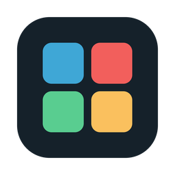
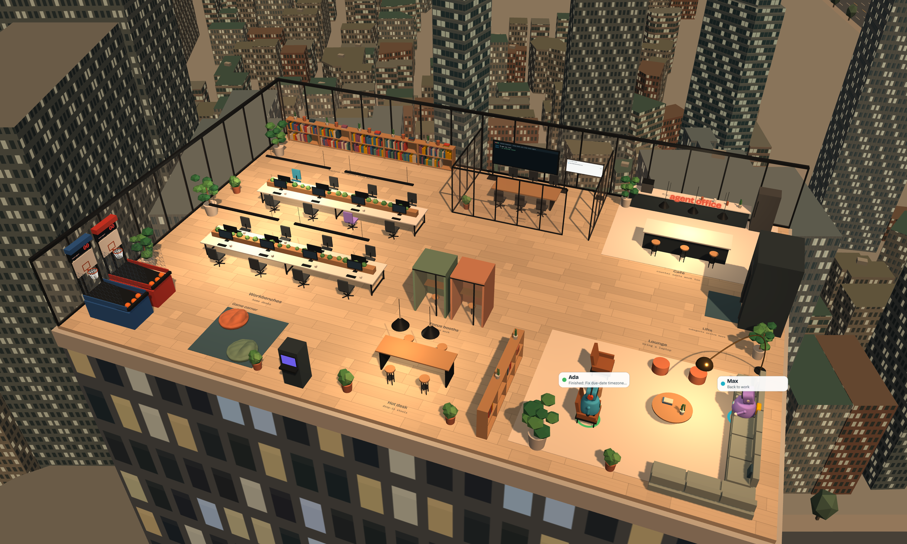
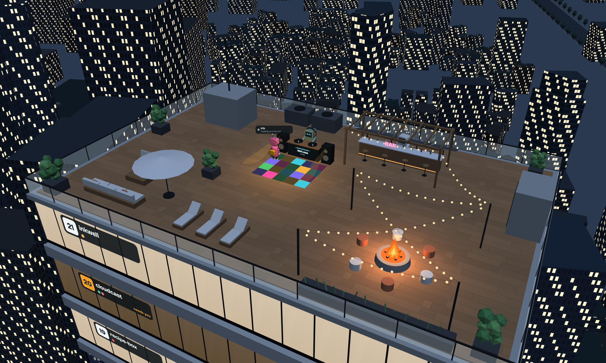

#  Agent Office

A 3D office where your coding agents work. Every session you run in the **Claude desktop app**, the **terminal**, T3 Code, Codex, Cursor and [other tools](#other-coding-agents) becomes an agent that rides up in the lift, takes a desk, walks to the library when it researches, raises a hand when it needs your permission, and heads to the lounge when it's done. A session that ends and resumes keeps its desk. Subagents show up as smaller teammates, and ones already at work when you open the office come back with them. When one finishes, it stays at its desk while its main agent walks over to review the work, then lets it go.

Works in any browser on your computer. Phone and VR headset support comes next (see the roadmap).

https://github.com/user-attachments/assets/7734fd2b-2400-4ac0-aedf-d976f908f321

*A 33-second tour of the demo office: agents arrive at their desks, react to test runs, ask for permission, and party on the rooftop after dark. Recorded with `scripts/record-trailer.mjs`; city footprints © [OpenStreetMap contributors](https://www.openstreetmap.org/copyright).*

> **Preview.** Agent Office is early and Mac-first. The desktop app is signed and notarized by Apple. **Open chat** relies on how the Claude and Codex apps open their chats today; that isn't documented by either app and could change, in which case the button still brings the app forward. Issues and ideas are welcome.

## Quick start

**On a Mac:** download the DMG from the [latest release](https://github.com/regisBafutwabo/agent-office/releases/latest) and drag **Agent Office** to **Applications**. Open it and click **Connect Claude Code**. See the [installation guide](INSTALL.md) for details.

In **Customize → Connect agents**, each **Connect** button installs that tool's hooks. Start a new agent session afterward.

Full setup, including building from source and troubleshooting, is in **[INSTALL.md](INSTALL.md)**. From source, the short version is:

```bash
git clone https://github.com/regisBafutwabo/agent-office.git
cd agent-office
npm install
npm start                # starts the office and prints its link, http://localhost:4747/#k=…
```

Then install the hooks once, so Claude Code reports what it's doing:

```bash
claude plugin marketplace add "$(pwd)"
claude plugin install agent-office@agent-office
```

Open a **new** Claude Code session (desktop app or terminal) and send a prompt. Its agent appears in the office.

To try it without Claude Code, open <http://localhost:4747/?demo> for simulated agents.

## Other coding agents

Codex CLI, Cursor, Gemini CLI, GitHub Copilot CLI, Qwen Code, Factory Droid, Goose, Kiro, Windsurf, Cline, OpenCode and Amp can report to the office too, through `adapters/hook.sh`. The desktop app connects Codex and Cursor in one click (**Connect agents** in the menu bar or in Customize). Setup for the others is in [docs/adapters.md](docs/adapters.md). Works with both the desktop app and `npm start`.

**Ollama** needs no setup. Each model Ollama has loaded shows up on an Ollama floor: busy while it answers, idle while it waits, gone when Ollama unloads it. Ollama doesn't say which tool or project sent a prompt, so these agents can't ask for permission or show the chat.

## Desktop app (macOS)

A 4 MB menu-bar app with the office server built in, so you don't need `npm start` or Node:

- The menu-bar icon shows how many agents need you, and macOS notifies you when one asks for permission.
- **Connect agents** installs the Claude Code plugin and adds Codex or Cursor hooks in one click, so you don't need this repo. Newer app versions update the plugin by themselves.
- **Open Agent Office** shows the 3D office in a window. Closing the window frees its memory; the server keeps running in the menu bar until you quit.
- The app updates itself. To get a new version right away, choose **Check for Updates…** from the menu-bar icon or the Agent Office menu.
- **Open in browser** opens the office in your browser too, signed in with a one-time link.

Build it (needs Rust: `brew install rustup && rustup default stable`):

```bash
cd desktop
npm install
npm run dev      # run it
npm run build    # Agent Office.app and a .dmg in src-tauri/target/release/bundle/
```

A build of your own is ad-hoc signed, so other Macs may warn that the developer can't be verified. Follow the [first-launch instructions](INSTALL.md#allow-the-first-launch).

## How it works

```
Claude Code (desktop app / terminal)
   │  hooks from the agent-office plugin (plugin/hooks)
   ▼
bridge/server.js  ── keeps live state of every session and subagent
  (or the desktop app's built-in Rust server: desktop/src-tauri)
   │  WebSocket
   ▼
web/index.html    ── the 3D office (Three.js)
```

- The plugin's hook script posts each event to `http://127.0.0.1:4747/hook`. It gives up after one second and never blocks or changes what Claude Code does.
- The bridge only listens on `127.0.0.1`, so nothing leaves your machine. Prompts and file names are shown in the office, so treat it like your terminal.
- Two keys guard the office, each in a file only you can read in the data folder (`~/Library/Application Support/Agent Office`, or `~/.config/agent-office` on Linux). Hooks send `hook-token`, which can only report events and ask for permission. Office pages hold `ui-token`, which reads sessions and code and answers permission requests. Other accounts on the same computer, and web pages, get neither. Hooks from before 0.5.0 have no key, so their events are refused: update the plugin and start new sessions (see [INSTALL.md](INSTALL.md#updating)). The office also refuses requests whose `Host` isn't `localhost`, an IP address, or a name you allow, which stops DNS-rebinding pages.
- Model packs can only serve model and texture files (`.glb`, `.gltf`, `.bin`, `.png`, `.jpg`, `.webp`, `.ktx2`), never pages or scripts, and never a file a symlink points to outside the pack. The review window only shows files the card lists.
- Where agents go is decided by placement rules in `web/index.html` (search for "Placement rules"): three or more file reads in a row send an agent to the library, web research goes to the lounge, plan mode goes to the war room, and finished agents take a break after 45 seconds and then drift between the lounge, coffee bar, basketball machines, the arcade and the rooftop. Agents look around, stretch and sip coffee while they work.

## Characters

Agents are small robots with a screen for a face, and the face shows what the agent is doing: eyes looking up with "…" while thinking, focused while working, a big "!" when it needs you, happy ^ ^ when done, sleepy zZ when idle, and a frown when something failed. A light on the chest shows the same status color.

Pick **Pets** or **Robots** when you first open the office. Pets include a bear, cat, rabbit, Maltese, raccoon, and duck. Change crews anytime in **Customize → Agents**, and customize each agent's animal or robot face, body shape, colors, and accessories (headphones, beanie, cap, glasses, antenna, scarf, backpack, mug). Looks are remembered per project. Subagents automatically look like a smaller "intern" version of their parent, and agents from other tools get a default accessory (Cursor wears headphones, Codex a cap, and so on). Try looks side by side in `prototype/character-lab.html`.

The first-visit tour shows how project floors, agent activity, tool connections, and permission requests work. Skip it anytime or replay it from **Customize → Getting started**. With no agents running, **Try demo** opens a sample team; the tour can then take you back to your live office to connect your own tools.

## Day and night

The office follows your clock by default (**Customize → Office theme → Auto**): night until 5:00, dawn into daylight by 8:00, daylight until 17:00, then golden hour and night by 20:00. Colors and light blend through the transitions, the sun crosses the sky during the day, and the city lights come on at dusk. Pick any other theme to keep it fixed; your choice is remembered.

Choose **Seoul**, **San Francisco**, or **Generic city** on your first visit, or change it under **Customize → City**. City views combine bundled OpenStreetMap footprints with stylized landmarks and artistic scenery, with windows that light up at night. Your choice is saved on this device. See [the city data notes](web/cities/README.md) to change the office centers and rebake the snapshots.



*The actual demo scene, exported at 3000 × 1800 with fictional projects and the artistic Seoul skyline. City footprints © [OpenStreetMap contributors](https://www.openstreetmap.org/copyright). Click the image for full resolution.*

## Rooftop DJ

[](docs/images/rooftop-party.png)

*A lossless export of the demo's night scene. City footprints © [OpenStreetMap contributors](https://www.openstreetmap.org/copyright).*

The rooftop DJ can play what you're listening to. It's off until you go up to the rooftop and click **Play my music** at the top: macOS then asks once whether Agent Office may see Spotify and Music. From then on, the office asks the Spotify app for its current song, then Apple Music, and shows it on the front of the DJ booth. With your music on, the DJ plays by day too; the full party (lights, fire, bar) still waits for dark. With nothing playing, the DJ spins its own office mix of made-up tracks.

It only checks while an office page has it turned on, never opens Spotify or Music, and nothing leaves your machine. Click the button again to stop. The permission belongs to Agent Office (or your terminal, with `npm start`); to change it later, go to **System Settings → Privacy & Security → Automation**. The dance floor keeps its own beat, because Spotify no longer shares a song's tempo.

## Jumping to an agent's chat

Every live agent has an **↗** button in the agent list, and an **Open chat** / **Open in …** button on its card. When an agent finishes, a toast pops up with the same button, so one click takes you back to it.

- **Claude desktop app:** opens that exact chat (the plugin passes the app's session id; needs plugin 0.4.0).
- **Codex app:** opens that exact thread.
- **T3 Code:** opens that session's own conversation (needs plugin 0.4.2).
- **Terminal and iTerm:** selects the tab running that session.
- **Cursor, VS Code, Windsurf, Zed:** opens that project's window, where its agent chat lives.
- **Anything else on the list:** brings the app forward.

The desktop app asks once for permission to control Terminal or iTerm. It only ever opens apps from a fixed list of coding tools, and chat links are built from validated ids only (see `desktop/src-tauri/src/focus.rs`), on macOS.

## App logos

Floors and agents show the logo of the tool they come from (Claude, Codex, Cursor…) in the Floors list, the agent list and on the floor signs. The logos are the real icons of the apps installed on your Mac, read from macOS by the local office, so no artwork ships with this repo. Tools without an installed app, and the claude.ai preview, show a lettered badge.

## Heads-ups

The office points out three things you'd want to know about before they bite:

- **Same file:** two agents edited the same file within 5 minutes. A red bar joins them, and both cards say who else is editing it, since one may overwrite the other's work.
- **Going in circles:** the same tool call (say, `npm test`) failed 3 times without once working. The agent raises its hand with a red marker and a "?" on its face. A new prompt, a passing run or finishing clears it.
- **Memory:** a cup on each Claude Code agent's name tag drains as its chat fills the context window, and the card shows the token count. At 80% you get a heads-up that Claude Code will compact it soon. Transcripts don't say how big the window is, so the office assumes 200k until a chat holds more, then 1M.

The first two live in the open office page: reloading it forgets them, and they don't count toward the menu-bar badge.

## Reactions and desk memories

Agents react to how a command went, not to finishing a reply:

- **Still running:** a gear turns beside an agent whose command has run for more than 6 seconds.
- **Passed after a long run:** a command that took 20 seconds or more drops a parcel on the desk.
- **Failed:** a puff of soot.
- **Comeback:** a command that failed and then passes gets a short cheer and confetti. If it had failed 3 times or more, the cheer is bigger and the desk remembers it.

Each reaction pops a manga-style bubble above the agent that says what happened, with the command and how long it took underneath: **PASSED!**, **FAIL…**, **YES!** or **FINALLY!!**, and a thought cloud counting the seconds while a command runs. Passes also get a line in the Activity feed.

Each project's desk keeps what happened there. A plant grows after 1, 3, 7, 14 and 30 days of work, every merge adds a gold cup (the first becomes a big one at five), and a steel knot marks the times an agent got itself unstuck. The agent's card lists the dated moments under **Desk memories**. Memories hold counts and dates only, never prompts, commands or file names, and they are saved in this browser.

## Reviewing what changed

An agent's card shows what its checkout holds that you haven't reviewed, so you don't have to open a diff to find out:

- **Files to review:** the count of changed files, including committed, uncommitted and untracked ones, since the checkout's base branch (`origin/HEAD`, else `main`, `master` or `develop`).
- **Latest reported edit:** the file an agent last changed, with the lines it took out and put in. Hooks report an edit once it is made, so the lines appear whole.
- **Review:** opens the file list beside one file's diff. The diff stays still while you read; if the file changes meanwhile, the window says so and lets you load the new version. A dot shows which agent reported an edit to a file. **Refresh** reads the checkout again; the office also re-reads every checkout on the war room's board when you zoom onto a screen or come back to the window, so a commit or stash you made by hand shows up.
- **Mark reviewed:** remembers the versions you saw, in this browser. A file comes back when it changes again.

Git reads the checkout, so agents working in one folder share one list, and the card says when that is the case. Claude Code reports the changed lines; other tools show the file name only. To keep code out of the office altogether, turn off **Customize → Show code in agent cards and reviews**: the office then keeps and shows file names only.

The two screens in the war room show the same thing for the whole floor. The large one is a review board: one row per session with its files to review, its last command, its active subagents and the files it reported editing. The small one shows the floor's latest reported edit. Click a screen to bring the camera up close, click a row on the board to open that session's review, and press Escape or click away to go back. The screens are 3D only; the plan view doesn't show them.

## Everything that needs you, in one place

Agents from every tool you run show up together: the Claude app, the terminal, T3 Code, Codex, Cursor and the rest.

- **Needs you:** a strip at the top lists every agent waiting on you, oldest first, with the tool and project it's in. Answer a held permission request right there with **Allow** or **Deny**, or jump to the agent's app with **Open**.
- **By tool:** the agent list can be grouped by project (one floor each) or by the tool each agent runs in.
- **Wall mode:** the **Wall** button goes full screen with only the building, the "needs you" strip and a big status light per agent, for a spare monitor or a TV. Press Esc to leave.

## Approving from the office

When an agent needs permission, it raises its hand and its floor pulses amber. If the office is open on your screen, you can answer right there: **Allow**, **Deny**, or **Answer in Claude Code**. You can do this from the agent's card or from the pop-up alert.

- Claude Code runs its permission hook *before* showing its own dialog. So the office only holds a request while at least one office page is visible, and for at most 45 seconds. After that, or if nobody is watching, Claude Code asks you as usual with no delay.
- Denied requests tell Claude "Denied from Agent Office", so it can try another way.
- Only pages served by the office itself can connect. Requests from other websites are refused, so a web page can't approve commands on your machine.

This works with Claude Code today. Codex, Copilot CLI, Gemini CLI, Cursor and Factory hooks can also allow or deny, so they can be added the same way.

## Options

| Setting | Default | What it does |
|---|---|---|
| `AGENT_OFFICE_PORT` | `4747` | Port for the bridge. Set it for Claude Code too if you change it, since the hook script reads it. |
| `AGENT_OFFICE_HOST` | `127.0.0.1` | Interface the bridge listens on: `127.0.0.1`, `::1` or `localhost`. The bridge refuses any other address, since its keys would cross the network unencrypted. To use the office from another device, forward the port over SSH (`ssh -L 4747:127.0.0.1:4747 your-mac`). |
| `AGENT_OFFICE_ALLOWED_HOSTS` | | Comma-separated host names, besides `localhost` and IP addresses, that may address the office (say `my-mac.local`). |
| `AGENT_OFFICE_DATA` | see above | Folder for the keys (`ui-token`, `hook-token`). Set it for your agents too, since the hooks read it. |
| `?demo` | | Simulated agents instead of live sessions. |
| `?fast` | | Shorter idle timers, useful when testing. |
| `?time=18:45` | | Preview the **Auto** theme at another hour. |

## Uninstall the hooks

```bash
claude plugin uninstall agent-office@agent-office
claude plugin marketplace remove agent-office
```

## Development

Contributors: branch from `develop` and open your pull request against `develop`. It is merged into `main` for each release. See [CONTRIBUTING.md](CONTRIBUTING.md) for the full steps.

```bash
npm test                                  # bridge and city bake unit tests
npm run test:e2e                          # the office page in a browser (first run: npx playwright install chromium)
(cd desktop/src-tauri && cargo test)      # desktop app server tests
claude --plugin-dir ./plugin              # try the hooks in one session without installing them
```

## License

[MIT](LICENSE). Agent Office isn't affiliated with Anthropic, OpenAI, Cursor or the other tools it works with. App logos in the office are read from the apps installed on your Mac, not shipped with this repo.

## Roadmap

1. ~~Live sessions from the desktop app and terminal (read-only)~~
2. ~~Approve or deny permission requests from the office, desktop notifications~~
3. Phone and VR over your local network (HTTPS for WebXR)
4. Give agents tasks from the office (sessions started through the Agent SDK)
5. ~~Desktop app (Tauri) with a menu-bar icon~~; custom 3D model packs and code signing next
