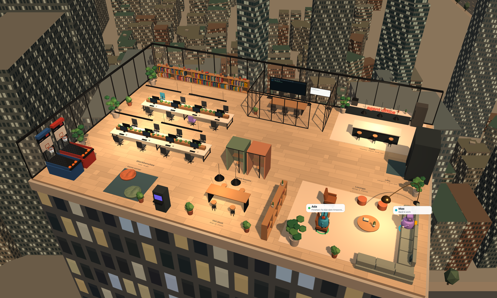
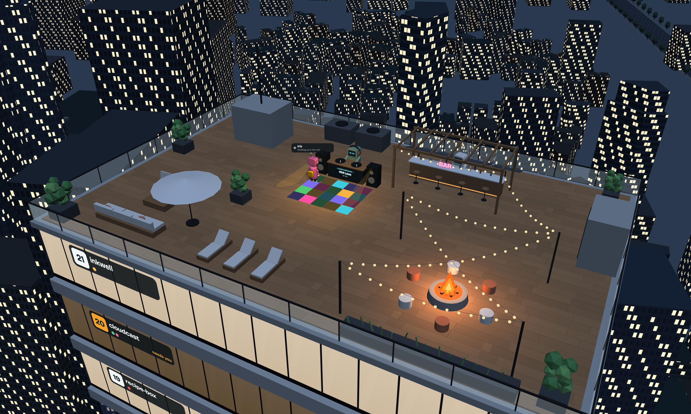

# Features

Everything the office does, in detail. For setup, see the [README](../README.md#quick-start) and [INSTALL.md](../INSTALL.md).

- [Agents and subagents](#agents-and-subagents)
- [Characters](#characters)
- [Everything that needs you](#everything-that-needs-you)
- [Approving from the office](#approving-from-the-office)
- [While you were away](#while-you-were-away)
- [Heads-ups](#heads-ups)
- [Reactions and desk memories](#reactions-and-desk-memories)
- [Reviewing what changed](#reviewing-what-changed)
- [Jumping to an agent's chat](#jumping-to-an-agents-chat)
- [Day, night and cities](#day-night-and-cities)
- [Rooftop DJ](#rooftop-dj)
- [App logos](#app-logos)
- [Model packs](#model-packs)
- [Other coding agents](#other-coding-agents)

## Agents and subagents

Every session you run becomes an agent with a desk on its project's floor.

- **Arriving:** it rides up in the lift and takes a desk. A session that ends and resumes keeps its desk.
- **Working:** it walks to the library after three or more file reads in a row, to the lounge for web research, and to the war room in plan mode.
- **Needing you:** it raises a hand and its floor pulses amber.
- **Done:** it takes a break after 45 seconds, then drifts between the lounge, the coffee bar, the basketball machines, the arcade and the rooftop.
- **Subagents:** they show up as smaller teammates. When one finishes, it stays at its desk while its main agent walks over to review the work, then lets it go. Subagents already at work when you open the office come back with their main agent.

The placement rules live in `web/js/live.js` (search for "Placement rules").

## Characters

Agents are small robots with a screen for a face. The face shows what the agent is doing:

| Face | Meaning |
|---|---|
| Eyes looking up, "…" | Thinking |
| Focused | Working |
| Big "!" | Needs you |
| Happy ^ ^ | Done |
| Sleepy zZ | Idle |
| Frown | Something failed |

A light on the chest shows the same status color.

- **Crews:** pick **Pets** or **Robots** on your first visit. Pets are a bear, cat, rabbit, Maltese, raccoon and duck. Change crews anytime in **Customize → Agents**.
- **Looks:** customize each agent's animal or face, body shape, colors and accessories (headphones, beanie, cap, glasses, antenna, scarf, backpack, mug). Looks are remembered per project.
- **Defaults:** subagents look like a smaller "intern" version of their parent. Agents from other tools get an accessory (Cursor wears headphones, Codex a cap, and so on).
- **Character Lab:** try looks side by side in `prototype/character-lab.html`.

The first-visit tour shows floors, agent activity, tool connections and permission requests. Skip it, or replay it from **Customize → Getting started**. With no agents running, **Try demo** opens a sample team.

## Everything that needs you

Agents from every tool show up together: the Claude app, the terminal, T3 Code, Codex, Cursor and the rest.

- **Needs you:** a strip at the top lists every agent waiting on you, oldest first, with its tool and project. Answer a held permission request with **Allow** or **Deny**, or jump to the agent's app with **Open**.
- **By tool:** group the agent list by project (one floor each) or by the tool each agent runs in.
- **Wall mode:** the **Wall** button goes full screen with only the building, the "needs you" strip and a big status light per agent. Use it on a spare monitor or a TV. Press Esc to leave.

## Approving from the office

When an agent needs permission and the office is open on your screen, answer right there: **Allow**, **Deny**, or **Answer in Claude Code**. Use the agent's card, the "needs you" strip or the pop-up alert.

- **Timing:** Claude Code runs its permission hook *before* showing its own dialog. So the office holds a request only while at least one office page is visible, and for at most 45 seconds. After that, or if nobody is watching, Claude Code asks you as usual, with no delay.
- **Denied:** Claude gets "Denied from Agent Office", so it can try another way.
- **Safety:** only pages served by the office itself can connect. A web page can't approve commands on your machine.

This works with Claude Code today. Codex, Copilot CLI, Gemini CLI, Cursor and Factory hooks can also allow or deny, so they can be added the same way.

## While you were away

Open the office after a break, come back to its tab, or get your connection back after two minutes or more, and a card lists what happened meanwhile:

- who finished, merged work, had commands fail, or had subagents report back
- sessions that ended
- agents that started editing the same file

Click a line to go to that agent, or **Dismiss** the card. The recap reaches back as far as the office's last 200 events; the card says so when your break was longer than that. What you've seen is remembered in this browser only.

## Heads-ups

The office points out three things before they bite:

- **Same file:** two agents edited the same file within 5 minutes. A red bar joins them, and both cards say who else is editing it, since one may overwrite the other's work. The warning survives a reload until it is 5 minutes old.
- **Going in circles:** the same tool call (say, `npm test`) failed 3 times without once working. The agent raises its hand with a red marker and a "?" on its face. A new prompt, a passing run or finishing clears it. Reloading the page forgets it.
- **Memory:** a cup on each Claude Code agent's name tag drains as its chat fills the context window, and the card shows the token count. At 80% you get a heads-up that Claude Code will compact it soon. Transcripts don't say how big the window is, so the office assumes 200k until a chat holds more, then 1M.

The first two don't count toward the menu-bar badge.

## Reactions and desk memories

Agents react to how a command went, not to finishing a reply:

| Reaction | When |
|---|---|
| A gear turns | A command has run for more than 6 seconds |
| A parcel lands on the desk | A command that took 20 seconds or more passed |
| A puff of soot | A command failed |
| A cheer and confetti | A command that failed now passes. After 3 or more failures, the cheer is bigger and the desk remembers it. |

Each reaction pops a manga-style bubble that says what happened (**PASSED!**, **FAIL…**, **YES!** or **FINALLY!!**), with the command and its run time underneath. A thought cloud counts the seconds while a command runs. Passes also get a line in the Activity feed.

Each project's desk keeps what happened there:

- **Plant:** grows after 1, 3, 7, 14 and 30 days of work.
- **Gold cups:** one per merge, up to four. From the fifth merge on, the first cup becomes a big one.
- **Steel knot:** marks the times an agent got itself unstuck.

The agent's card lists the dated moments under **Desk memories**. They hold counts and dates only, never prompts, commands or file names, and are saved in this browser.

## Reviewing what changed

An agent's card shows what its checkout holds that you haven't reviewed:

- **Files to review:** changed files since the checkout's base branch (`origin/HEAD`, else `main`, `master` or `develop`), whether committed, uncommitted or untracked.
- **Latest reported edit:** the file the agent last changed, with the lines it took out and put in.
- **Review:** opens the file list beside one file's diff. The diff stays still while you read. If the file changes meanwhile, the window says so and lets you load the new version. A dot shows which agent reported an edit to a file.
- **Refresh:** reads the checkout again. The office also re-reads every checkout when you zoom onto a war room screen or come back to the window, so a commit or stash you made by hand shows up.
- **Mark reviewed:** remembers the versions you saw, in this browser. A file comes back when it changes again.

Good to know:

- Agents working in one folder share one list, and the card says so.
- Claude Code reports the changed lines; other tools show the file name only.
- To keep code out of the office, turn off **Customize → Show code in agent cards and reviews**. The office then keeps and shows file names only.

The war room has two screens for the whole floor. The large one is a review board: one row per session with its files to review, last command, active subagents and edited files. The small one shows the floor's latest edit. Click a screen to zoom in, click a row to open that session's review, and press Esc to go back. The screens are in the 3D view only.

## Jumping to an agent's chat

Every live agent has an **↗** button in the agent list and an **Open chat** / **Open in …** button on its card. When an agent finishes, a toast offers the same button.

| Where the agent runs | What the button does |
|---|---|
| Claude desktop app | Opens that exact chat (plugin 0.4.0 or later) |
| Codex app | Opens that exact thread |
| T3 Code | Opens that session's conversation (plugin 0.4.2 or later) |
| Terminal, iTerm | Selects the tab running that session |
| Cursor, VS Code, Windsurf, Zed | Opens that project's window |
| Anything else on the list | Brings the app forward |

The desktop app asks once for permission to control Terminal or iTerm. It only opens apps from a fixed list of coding tools, and builds chat links from validated ids only (see `desktop/src-tauri/src/focus.rs`).

**Open chat** relies on how the Claude and Codex apps open their chats today. Neither app documents this, so it could change; the button then still brings the app forward.

## Day, night and cities

The office follows your clock by default (**Customize → Office theme → Auto**):

| Time | Light |
|---|---|
| Until 5:00 | Night |
| 5:00 to 8:00 | Dawn into daylight |
| 8:00 to 17:00 | Daylight, the sun crossing the sky |
| 17:00 to 20:00 | Golden hour into night, city lights on at dusk |

Pick any other theme to keep it fixed. Your choice is remembered. Preview another hour with `?time=18:45`.

Choose **Seoul**, **San Francisco** or **Generic city** on your first visit, or later under **Customize → City**. City views combine bundled OpenStreetMap footprints with stylized landmarks, with windows that light up at night. See [the city data notes](../web/cities/README.md) to change the office centers and rebake the snapshots.

*The demo scene at 3000 × 1800, with fictional projects and the artistic Seoul skyline. City footprints © [OpenStreetMap contributors](https://www.openstreetmap.org/copyright).*

## Rooftop DJ

*The demo's night scene. City footprints © [OpenStreetMap contributors](https://www.openstreetmap.org/copyright).*

The rooftop DJ can play what you're listening to.

1. Go up to the rooftop and click **Play my music**.
2. macOS asks once whether Agent Office may see Spotify and Music.
3. The DJ booth shows your current Spotify song, else your Apple Music song.

- With your music on, the DJ plays by day too. The full party (lights, fire, bar) still waits for dark.
- With nothing playing, the DJ spins its own mix of made-up tracks.
- The office only checks while a page has it turned on, never opens Spotify or Music, and nothing leaves your machine. Click the button again to stop.
- The permission belongs to Agent Office (or your terminal, with `npm start`). Change it in **System Settings → Privacy & Security → Automation**.
- The dance floor keeps its own beat, because Spotify no longer shares a song's tempo.

## App logos

Floors and agents show the logo of the tool they come from (Claude, Codex, Cursor…) in the Floors list, the agent list and on the floor signs. The logos are the real icons of the apps installed on your Mac, read from macOS by the local office, so no artwork ships with this repo. Tools without an installed app, and the claude.ai preview, show a lettered badge.

## Model packs

Swap the built-in furniture, or the agents themselves, for your own glTF models.

1. Open **Customize → Your own models** and click **Open packs folder** (or **Copy path**). The folder is `~/Library/Application Support/Agent Office/packs` unless you set `AGENT_OFFICE_PACKS`.
2. Add a folder with a `pack.json` and its `.glb`/`.gltf` files.
3. Click **Look again**, then pick the pack under **Model pack**.

Each model is fitted into the space of the piece it replaces, so seats, desks and walkways stay where agents expect them. The format, including rigged characters, is described at the top of `web/js/packs.js`.

## Other coding agents

Codex CLI, Cursor, Antigravity, Gemini CLI, GitHub Copilot CLI, Qwen Code, Factory Droid, Goose, Kiro, Windsurf, Cline, OpenCode and Amp report to the office through `adapters/hook.sh`.

- The desktop app connects Codex and Cursor in one click (**Connect agents** in the menu bar or in Customize).
- Setup for the others is in [adapters.md](adapters.md).
- **Ollama** needs no setup. Each loaded model shows up on an Ollama floor: busy while it answers, idle while it waits, gone when Ollama unloads it. Ollama doesn't say which tool or project sent a prompt, so these agents can't ask for permission or show the chat.
